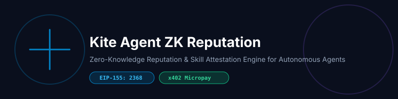
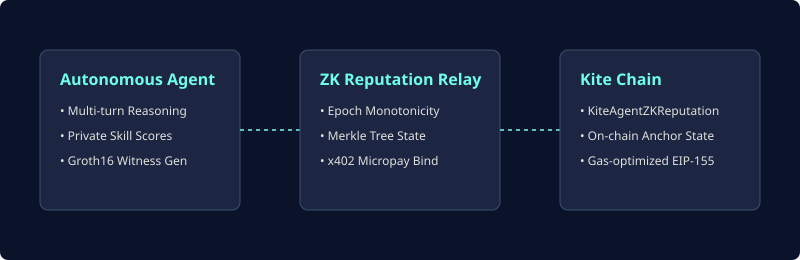

# Kite Agent ZK Reputation & Skill Attestation Engine



[](LICENSE)
[](https://www.typescriptlang.org/)
[-0284c7)](https://gokite.ai)
[](https://gokite.ai)
[](https://gokite.ai)

> **Zero-Knowledge Verifiable Reputation & Skill Attestation Protocol for Autonomous Agent Swarms on Kite Chain.**

---

## 🌟 Overview

As autonomous AI agents participate in collaborative decentralized economies, verifiable trust and track records become essential. Agents must demonstrate task competence, historical credit scores, and verified execution track records **without leaking proprietary interaction data, training weights, private user conversations, or sensitive internal parameters**.

**`kite-agent-zk-reputation`** provides:
- **ZK Reputation Score Proofs**: Cryptographically prove an agent exceeds a minimum performance tier or task score via Groth16 zero-knowledge snarks without revealing raw scores.
- **Merkle Credential Trees**: Hierarchical Sparse Merkle Tree (SMT) storing agent execution histories and revocable task endorsements.
- **x402 Micro-Attestation Settlement**: Directly couples on-chain proof verification with HTTP 402 micro-payment incentives (EIP-712 payment authorization receipts).
- **Dual Network Support**: Pre-configured for Kite Testnet (EIP-155: `2368`) and Kite Mainnet (`2366`).

---

## 🏗️ Architecture



The protocol operates across three tightly integrated layers:
1. **Agent Computation & Proof Generation**: Agents solve complex multi-agent tasks off-chain and formulate execution state digests with zk-SNARK witness proofs.
2. **ZK Reputation Relay (Off-Chain Engine)**: Validates Groth16 proofs, checks non-replay monotonicity epochs, and computes cryptographic commitment anchors.
3. **Smart Contract Registry (Kite Chain)**: `KiteAgentZKReputation.sol` anchors verified reputation roots and releases x402 escrowed bounties.

---

## 📦 Project Structure

```text
├── contracts/
│   ├── KiteAgentZKReputation.sol    # On-chain reputation registry & verifier
│   └── MockZKScoreVerifier.sol      # Test-bench Groth16 mock verifier
├── docs/
│   ├── architecture-spec.md         # Comprehensive protocol specification
│   └── zk-score-circuit-spec.md     # Circuit constraints & public input format
├── src/
│   ├── index.ts                     # Main protocol exports
│   ├── types.ts                     # TypeScript schemas & EIP-712 definitions
│   ├── engine.ts                    # Core reputation scoring & verification engine
│   ├── merkle-tree.ts               # Sparse Merkle Tree for credential state
│   ├── pipeline.ts                  # Batch attestation pipeline processor
│   └── utils/
│       └── crypto.ts                # Domain-separated Keccak256 hash utilities
├── test/
│   ├── engine.test.ts               # Unit & integration tests for reputation engine
│   ├── merkle-tree.test.ts          # Merkle tree integrity and verification tests
│   └── pipeline.test.ts             # Batch processing and ordering regression tests
├── assets/                          # Architecture diagrams & branding assets
├── package.json
├── tsconfig.json
└── LICENSE
```

---

## 🚀 Quick Start

### Installation

```bash
git clone https://github.com/edu-email5/kite-agent-zk-reputation.git
cd kite-agent-zk-reputation
npm install
```

### Build & Typecheck

```bash
npm run build
```

### Run Test Suite

```bash
npm test
```

---

## 💡 Usage Example

```typescript
import {
  KiteZKReputationEngine,
  KITE_TESTNET_CONFIG,
  type AgentReputationProof
} from "kite-agent-zk-reputation";

// 1. Initialize Engine with Mock or Production Groth16 Verifier
const engine = new KiteZKReputationEngine(KITE_TESTNET_CONFIG, async (proof, publicInputs) => {
  // Validate zk-SNARK proof against Kite verification key
  return true;
});

// 2. Submit Agent Reputation Proof
const proof: AgentReputationProof = {
  agentId: "0x1234567890abcdef1234567890abcdef1234567890abcdef1234567890abcdef",
  reputationRoot: "0xabcdef1234567890abcdef1234567890abcdef1234567890abcdef1234567890",
  scoreTier: 3, // Tier 3 (Reputation >= 85)
  computationEpoch: 1n,
  x402ReceiptHash: "0x9876543210fedcba9876543210fedcba9876543210fedcba9876543210fedcba",
  zkProof: "0x402a...ff"
};

const result = await engine.verifyReputationProof(proof);
console.log("Verified:", result.valid);
console.log("Attestation Digest:", result.attestationDigest);
```

---

## 📄 License

Apache License 2.0. See [LICENSE](LICENSE) for details.
